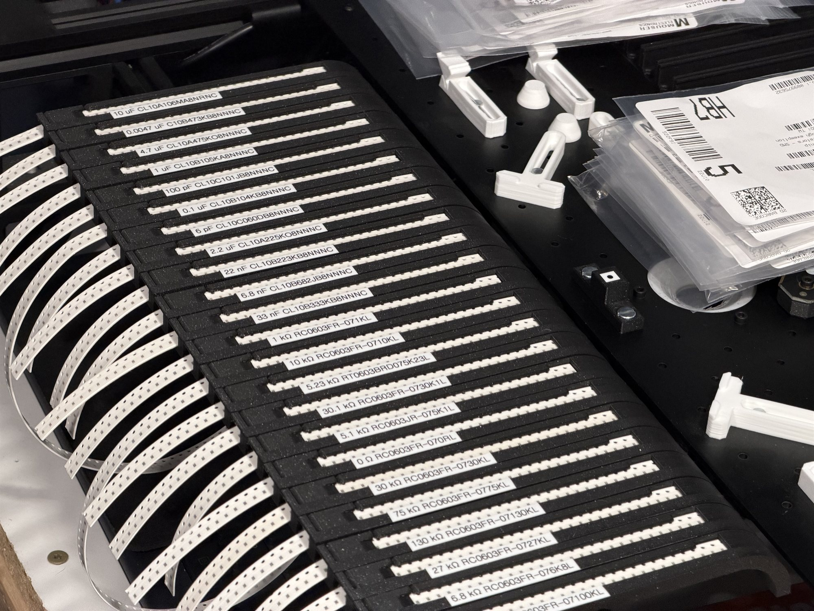

# 8mm Paper Tape Strip Feeders for LumenPNP

3D-printable strip feeders for **8mm SMT paper tape** on the front rail of a [LumenPNP](https://www.opulo.io/) pick and place machine. The design comes in three variants, one for each tape thickness. The original SOLIDWORKS source files are included so you can modify the design.

> [!WARNING]
> **This is an experimental design.** I have not fully tested or verified these feeders for reliable, hands-off production use. Read the [Known Issues](#known-issues) before you rely on them, and test them on your own machine with your own tape first.



## Demo Video

Watch the feeders working on a LumenPNP:

[](https://youtu.be/cuUacdHDwvA)

https://youtu.be/cuUacdHDwvA

## Variants

Pick the variant that matches the thickness of your tape. Measure the tape with calipers if you aren't sure.

| Tape thickness | STEP file | SOLIDWORKS source |
|---|---|---|
| 0.7 mm | [8mm_0.7mm_front_paper.STEP](step-conversion/8mm_0.7mm_front_paper.STEP) | [8mm_0.7mm_front_paper.SLDPRT](solidworks-source/8mm_0.7mm_front_paper.SLDPRT) |
| 1.0 mm | [8mm_1.0mm_front_paper.STEP](step-conversion/8mm_1.0mm_front_paper.STEP) | [8mm_1.0mm_front_paper.SLDPRT](solidworks-source/8mm_1.0mm_front_paper.SLDPRT) |
| 1.1 mm | [8mm_1.1mm_front_paper.STEP](step-conversion/8mm_1.1mm_front_paper.STEP) | [8mm_1.1mm_front_paper.SLDPRT](solidworks-source/8mm_1.1mm_front_paper.SLDPRT) |

If your tape has a different thickness, you will need to edit the model. See [Known Issues](#known-issues).

### Front Rail Only (for now)

The `front` in each filename means these models fit the **front rail** of the LumenPNP. The design could be adapted to fit the back rail, but I haven't made back-rail models yet.

## Repository Layout

```
.
├── media/                 # Photos
├── solidworks-source/     # Original SOLIDWORKS part files (.SLDPRT)
├── step-conversion/       # STEP exports for use in other CAD tools and slicers
├── LICENSE                # CERN-OHL-P-2.0
└── README.md
```

## Known Issues

These are the problems I know about. There may be others.

- **Parts can jump out of the tape.** The pick window is long, so when you handle or remove a feeder, components can jump out of their pockets.
- **The feeder must sit level.** If the feeder is tilted forward or backward instead of sitting parallel to the build plate, the pick height (Z) changes along the feeder. This can cause missed or failed picks.
- **Each tape thickness needs its own model.** The three variants only cover 0.7 mm, 1.0 mm, and 1.1 mm tape. Other thicknesses require editing the 3D model.
- **No back-rail models yet.** All three variants are for the front rail only.
- **Removing a loaded feeder can spill parts.** Once the components are exposed, it is hard to take a feeder off the machine without spilling them.

## Project Status

I'm sharing this design as-is and **don't plan to maintain it**. I won't be reviewing issues or pull requests.

You're encouraged to fork the repository and take it wherever you like, whether that means fixing the known issues, adding new tape thicknesses, or making back-rail versions. The license lets you do all of this without asking permission.

## License

This design is released under the [CERN Open Hardware Licence Version 2 – Permissive](LICENSE) (CERN-OHL-P-2.0).

You can use, modify, print, sell, and redistribute it, including in commercial or closed-source products, without asking permission. The main condition is that you keep the license and copyright notices with any copies of the source files you share.

The design is provided **as is, with no warranty**. See the [LICENSE](LICENSE) file for the full terms.
